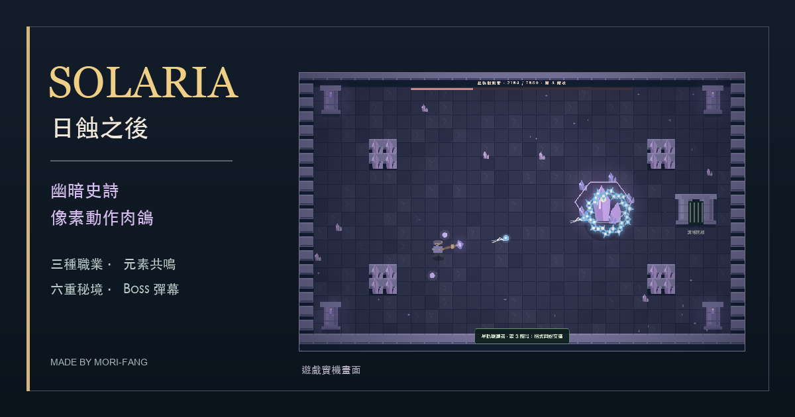

[開始遊玩 Solaria](https://sces5504.github.io/Solaria/)

  

# Solaria · 日蝕之後

**三種職業，兩種元素共鳴，一段穿越六重秘境的旅途。**

幽暗史詩像素風的俯視動作肉鴿。選擇劍士、弓箭手或法師，運用元素共鳴、升級與配裝，穿越六重秘境，挑戰守衛與最終 Boss「索拉里斯・蝕日之王」。

[操作指南](#操作) · [下載離線版](https://github.com/sces5504/Solaria/blob/main/index.html)

**需要電腦鍵盤與滑鼠。** 可直接在瀏覽器遊玩，也可下載 `index.html` 後離線開啟，不需安裝套件、登入帳號或啟動伺服器。

## 旅途與構築

- **三種職業：** 劍士以格擋反擊掌握近戰時機；弓箭手蓄力發射貫穿箭；法師引爆目標附近的元素狀態。
- **元素共鳴：** 每局最多從升級取得火、冰、水、電中的兩種，流血不佔名額。濕潤可強化連鎖閃電，水火相遇產生會傷害雙方的蒸汽；流血累積到門檻時爆發，同一目標會逐漸產生抗性。
- **升級與裝備：** 清場後選擇升級，發展元素專精、職業能力與防禦手段；比較裝備稀有度與詞條，搭配護甲、護符及戒指。精英、關卡詞條與隨機事件帶來額外挑戰及獎勵。
- **六重秘境：** 暮色草原、幽冥地城、永夜冰原、腐敗之地、燼火山脈、星空之境，每五區更換地形。各地形有三位隨機守衛，共十八位；擊敗最終 Boss 後可選擇挑戰下一週目。

## 操作

| 操作 | 按鍵 |
| --- | --- |
| 移動 | WASD／方向鍵 |
| 瞄準、普攻 | 滑鼠、左鍵 |
| 職業技能 | 右鍵；弓箭手按住蓄力、放開發射 |
| 閃避 | 空白鍵 |
| 拾取裝備、開寶箱、進入出口 | E |
| 背包與配裝 | I |
| 暫停 | Esc |
| 切換音效 | M |

清除敵人後，自動收集裝備以外的掉落物，再處理待選升級；裝備可自行挑選，準備好後靠近出口按 E 前進。

每局死亡後，等級、升級、裝備與金幣重新開始。最高分保存在目前瀏覽器的 `localStorage`，清除網站資料會移除紀錄。金幣用於計分：每區 100 分、普通／精英擊殺 25 分、守衛 Boss 250 分、事件 Boss 175 分、最終 Boss 1,500 分、每枚金幣 10 分；Boss 不重複計入普通擊殺。

製作：**Mori-Fang**。遊戲本體以單一 HTML、Canvas 程式繪圖及 Web Audio 合成音效製作，不依賴外部素材、字型、服務或函式庫。
