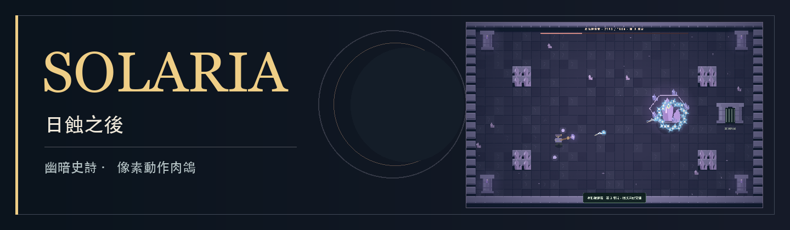

[開始遊玩 Solaria](https://sces5504.github.io/Solaria/)

  

 

# Solaria

Solaria 是一款幽暗像素風的俯視動作肉鴿，以走位、出招時機與元素搭配為核心。從草原一路深入星空之境，在每次清場後選擇新的能力，為下一場戰鬥調整配裝。

[操作指南](#操作) · [離線遊玩](#遊玩與紀錄)

## 玩法特色

- **三種職業，三種出招節奏。** 劍士抓準時機格擋反擊，弓箭手蓄力射出貫穿箭，法師引爆敵人附近的元素狀態。
- **用元素改變戰局。** 每局可從火、冰、水、電中學習最多兩種共鳴，再發展對應專精。濕潤能強化連鎖閃電；水火相遇會產生傷害敵我的蒸汽。流血獨立累積、不佔共鳴名額，同一目標爆血後會逐漸產生抗性。
- **在戰鬥之間重整構築。** 清場後選擇升級，搭配護甲、護符與戒指的稀有度和詞條。精英、關卡詞條與隨機事件帶來額外挑戰和獎勵。
- **穿越六重秘境，迎戰隨機守衛。** 每五區依序更換暮色草原、幽冥地城、永夜冰原、腐敗之地、燼火山脈與星空之境。各地形有三位隨機出場的守衛；走完六重秘境後，迎戰「索拉里斯・蝕日之王」，勝利後可進入下一週目。

## 操作

**目前需要電腦鍵盤與滑鼠。** 開啟[遊戲頁面](https://sces5504.github.io/Solaria/)，選擇職業即可開始。

| 操作 | 按鍵 |
| --- | --- |
| 移動 | WASD／方向鍵 |
| 瞄準、普攻 | 滑鼠、左鍵 |
| 職業技能 | 右鍵；弓箭手按住蓄力、放開發射 |
| 閃避 | 空白鍵 |
| 拾取裝備、開寶箱、進入出口 | E |
| 背包與配裝 | I |
| 暫停 | Esc |
| 切換音效 | M |

清場後，裝備以外的掉落物會自動吸向角色，再顯示尚未選擇的升級。挑好裝備、準備妥當後，靠近出口按 **E** 前往下一區。

## 遊玩與紀錄

遊戲可直接在瀏覽器開啟，不需要帳號或伺服器。若要離線遊玩，下載專案中的 [`index.html`](https://github.com/sces5504/Solaria/blob/main/index.html)，再以瀏覽器開啟即可，無須安裝套件。

死亡後，本局的等級、升級、裝備與金幣歸零。最高分保存在目前瀏覽器的 `localStorage`；清除網站資料會一併移除紀錄。

計分規則

金幣用於計分：每完成一區 100 分，普通／精英擊殺 25 分，守衛 Boss 250 分，事件 Boss 175 分，最終 Boss 1,500 分，每枚金幣 10 分。Boss 不重複計入普通擊殺。

製作：**Mori-Fang**。遊戲以 Canvas 繪製原創像素場景，並以 Web Audio 合成音效；本體收錄在單一 HTML，不依賴外部素材、字型、服務或函式庫。
